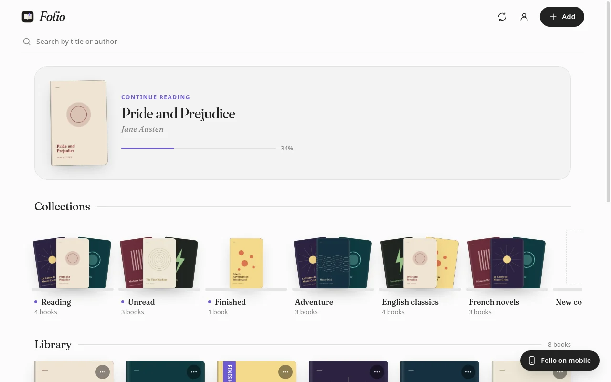

# Folio

**A calm, ad-free EPUB reader you host yourself.** Read in the browser, on your phone (installable web app),
or with the desktop apps for Windows, macOS and Linux. Your reading position, bookmarks, highlights,
collections and custom covers stay in sync across all of them.



*Version française : [README.fr.md](README.fr.md)*

## Features

- **Library**: covers, “continue reading”, search, automatic *Reading / Unread / Finished* categories, your own collections
- **Custom covers**: pick an image, or right-click (long-press on phones) an illustration inside the book
- **Reading**: paginated or scrolling, 7 themes, reading fonts, size, line spacing, margins, justification
- **Notes**: bookmarks and highlights in 4 colours, map of the book, Markdown export
- **Sync** between every device through your server; works offline once a book is downloaded
- **Accounts**: email confirmation, two-factor authentication (TOTP + recovery codes), sign-in alerts, device list
- **English and French** interface, emails and error messages

## Repository layout

| Folder | What it is |
|---|---|
| [`server/`](server) | Node.js server (Fastify + Prisma + SQLite): sync API, accounts, and the website it serves — home page `/`, reader `/app/`, downloads `/download` |
| [`desktop/`](desktop) | Windows and macOS app (Electron) that opens the reader of *your* server |
| [`linux/`](linux) | Native Linux app (Python, GTK 4, libadwaita, WebKitGTK), packaged as `.deb` |

## Quick start (server)

Requirements: Docker with Compose.

```bash
git clone https://github.com/<you>/folio.git
cd folio/server
cp .env.example .env        # then edit PUBLIC_URL and the SMTP settings
docker compose up -d --build
```

Folio is now on <http://127.0.0.1:8787>. Open `/app/`, create your account and confirm it with the emailed link
(without SMTP, the link is printed in `docker compose logs folio`).

### Putting it on the internet

The container only listens on `127.0.0.1`. Pick one:

- **Cloudflare Tunnel** (no open port): create a tunnel in Cloudflare Zero Trust pointing to `http://folio:8787`,
  paste its token in `TUNNEL_TOKEN`, then `docker compose --profile tunnel up -d --build`.
- **Reverse proxy** with HTTPS, e.g. Caddy:
  ```
  folio.example.org {
      reverse_proxy 127.0.0.1:8787
  }
  ```

HTTPS is required for phones to install the web app.

### Settings (`server/.env`)

| Variable | Default | |
|---|---|---|
| `PUBLIC_URL` | `http://127.0.0.1:8787` | Public address, used in emails and the QR code |
| `ALLOW_SIGNUP` | `true` | Set to `false` to close registrations |
| `QUOTA_MB` | `2048` | Storage per account |
| `SMTP_HOST`, `SMTP_PORT`, `SMTP_USER`, `SMTP_PASS`, `MAIL_FROM` | — | Outgoing email (port 465 = TLS, otherwise STARTTLS) |
| `TUNNEL_TOKEN` | — | Only for the `tunnel` profile |
| `FOLIO_SECRET` | — | Optional, replaces `data/secret.key` (encrypts 2FA secrets) |

### Backups

Back up the whole `server/data/` folder: `folio.db`, `files/`, `covers/`, `avatars/` and **`secret.key`**
(without it, existing two-factor authentications stop working).

### Offering the apps on `/download`

Put installers in `server/downloads/` (no restart needed). The page picks the newest file of each kind by name:
`Folio-Setup-X.Y.Z.exe`, `Folio-X.Y.Z-mac-arm64.zip`, `Folio-X.Y.Z-mac-x64.zip`, `Folio-X.Y.Z-linux.deb`.

## Building the apps

**Windows / macOS** (built from Linux; Wine is needed for the Windows installer):

```bash
cd desktop
npm ci
FOLIO_URL=https://folio.example.org node build.js all   # or: win, mac
```

Files end up in `desktop/dist/`. They are not code-signed: Windows shows a SmartScreen warning
(*More info → Run anyway*); on macOS run once
`xattr -cr /Applications/Folio.app && codesign --force --deep --sign - /Applications/Folio.app`.

**Linux** (Debian, Ubuntu and derivatives):

```bash
cd linux
FOLIO_URL=https://folio.example.org ./build_deb.sh      # FOLIO_URL only pre-fills the sign-in dialog
sudo apt install ./folio-reader_*_all.deb
```

Run without installing: `python3 linux/src/app.py` (needs `python3-gi gir1.2-gtk-4.0 gir1.2-adw-1 gir1.2-webkit-6.0`).
The Linux app can also sync through a plain shared folder (Syncthing, Nextcloud…) instead of a server.

## Security notes

- Passwords hashed with scrypt; checked against known breaches (Have I Been Pwned, k-anonymity)
- Session tokens and email links stored as SHA-256 hashes only; sessions expire
- Rate limiting on sign-in, registration and sensitive actions; strict security headers and CSP
- The container runs as an unprivileged user on a read-only filesystem

## License

[MIT](LICENSE)
